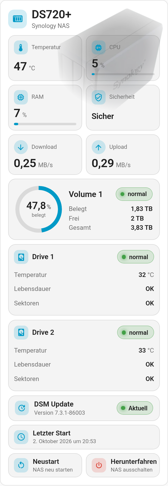

  

# NAS Card

**English** | [Deutsch](https://github.com/BeGiBue/home-assistant-nas-card#deutsch)

## English

Home Assistant card for NAS systems, preconfigured for a Synology DS720+.

The card is shown in German when Home Assistant is set to German, and in English otherwise.

### Requirements

- Home Assistant with custom card support and the assigned entities; the card does not set up the device integration itself.
- Actions run with the signed-in user's permissions. The card shows two drives and does not replace NAS monitoring.

Independent community project, not affiliated with, endorsed or published by Synology or Home Assistant. **Synology** and **DiskStation** are trademarks of their respective owners. License: [AGPL-3.0-only](https://github.com/BeGiBue/home-assistant-nas-card/blob/main/LICENSE).

## Deutsch

[English](https://github.com/BeGiBue/home-assistant-nas-card#english) | **Deutsch**

Home-Assistant-Karte für NAS-Systeme, vorkonfiguriert für eine Synology DS720+.

Die Karte erscheint auf Deutsch, wenn Home Assistant auf Deutsch eingestellt ist, sonst auf Englisch.

### Voraussetzungen

- Home Assistant mit Custom-Card-Unterstützung und die zugeordneten Entitäten; die Karte richtet die Geräteintegration nicht selbst ein.
- Aktionen laufen mit den Rechten des angemeldeten Benutzers. Die Karte zeigt zwei Laufwerke und ersetzt keine NAS-Überwachung.

Unabhängiges Community-Projekt, ohne Verbindung zu Synology oder Home Assistant und von beiden weder unterstützt noch herausgegeben. **Synology** und **DiskStation** sind Marken ihrer jeweiligen Rechteinhaber. Lizenz: [AGPL-3.0-only](https://github.com/BeGiBue/home-assistant-nas-card/blob/main/LICENSE).
